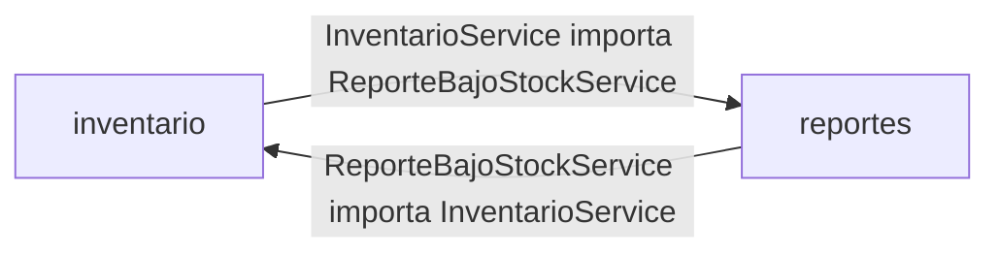
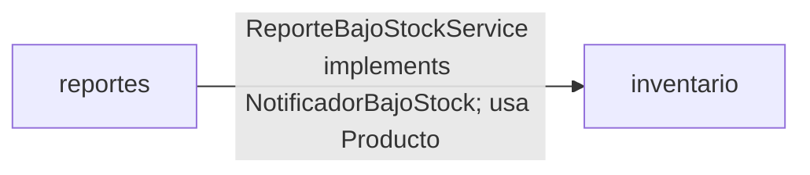

# refactoring-u11 — Red de seguridad, refactorización guiada por evidencia y ciclos entre paquetes

Post-contenido, Unidad 11 (Patrones de Diseño de Software). Proyecto Maven único (Spring Boot 3.5.7, Java 17) con dos partes: **Parte 1**, caracterización y refactor de dos code smells; **Parte 2**, ciclo entre paquetes detectado con ArchUnit y resuelto con inversión de dependencias.

Fecha de ejecución: 2026-11-13 · Java: 22.0.2 (Oracle; compilación con `java.version` 17) · Maven: 3.9.16

---

## Parte 1 — Red de seguridad y refactorización

### 1.1 Evidencia de los code smells (código original, commit 1)

**Long Method — `InventarioService.actualizarInventario`.** Longitud medida: 44 líneas (firma a llave final), 30 de cuerpo. Complejidad ciclomática medida con JaCoCo: 13. Mezcla seis responsabilidades: (1) validación de los datos de entrada (id, cantidad y tipo de movimiento), (2) búsqueda lineal del producto en la lista, (3) regla de stock suficiente y aplicación del movimiento sobre el stock, (4) cálculo de la cantidad de reorden (`stockMinimo * 3 - nuevoStock`), (5) registro/auditoría del movimiento (lista `movimientos` y consola) y (6) decisión y emisión de la alerta de reorden.

**Switch Statement duplicado — `ClasificadorProducto` y `EtiquetadoProducto`.** Ambas clases ramifican con `switch` sobre `TipoProducto` (LIBRO, ELECTRONICO, ROPA, ALIMENTO). Evidencia (salida real de `grep -n "switch\|case " ...` sobre el commit 1):

```
src/main/java/com/universidad/refactoringu11/inventario/ClasificadorProducto.java:7:        switch (producto.getTipo()) {
src/main/java/com/universidad/refactoringu11/inventario/ClasificadorProducto.java:8:            case LIBRO:       return 0.0;
src/main/java/com/universidad/refactoringu11/inventario/ClasificadorProducto.java:9:            case ELECTRONICO: return producto.getPrecio() * 0.08;
src/main/java/com/universidad/refactoringu11/inventario/ClasificadorProducto.java:10:            case ROPA:        return producto.getPrecio() * 0.03;
src/main/java/com/universidad/refactoringu11/inventario/ClasificadorProducto.java:11:            case ALIMENTO:    return 2.50;
src/main/java/com/universidad/refactoringu11/inventario/EtiquetadoProducto.java:5:    // Mismo switch sobre TipoProducto que ClasificadorProducto — duplicacion estructural
src/main/java/com/universidad/refactoringu11/inventario/EtiquetadoProducto.java:7:        switch (producto.getTipo()) {
src/main/java/com/universidad/refactoringu11/inventario/EtiquetadoProducto.java:8:            case LIBRO:       return "[LIBRO] " + producto.getNombre() + " - Exento de IVA";
src/main/java/com/universidad/refactoringu11/inventario/EtiquetadoProducto.java:9:            case ELECTRONICO: return "[ELECTRO] " + producto.getNombre() + " - Garantia 1 ano";
src/main/java/com/universidad/refactoringu11/inventario/EtiquetadoProducto.java:10:            case ROPA:        return "[ROPA] " + producto.getNombre() + " - Ver talla";
src/main/java/com/universidad/refactoringu11/inventario/EtiquetadoProducto.java:11:            case ALIMENTO:    return "[ALIMENTO] " + producto.getNombre() + " - Perecedero";
```

Agregar un tipo nuevo obligaba a modificar las dos clases (más cualquier otra que ramificara por tipo).

### 1.2 Red de seguridad: pruebas de caracterización (commit 2)

Se escribieron 26 pruebas sobre el código original, antes de tocarlo. Todas pasaron en verde (`mvn test`: `Tests run: 26, Failures: 0, Errors: 0, Skipped: 0` — BUILD SUCCESS; 17 en `InventarioServiceTest`, 5 en `ClasificadorProductoTest`, 4 en `EtiquetadoProductoTest`).

| Clase | Prueba | Qué caracteriza |
|---|---|---|
| `InventarioServiceTest` | `entrada_incrementaStockYRetornaOk` | ENTRADA suma al stock y devuelve `OK_<stock>` (`OK_30`) |
| `InventarioServiceTest` | `salida_conStockSuficiente_descuentaYRetornaOk` | SALIDA con stock suficiente descuenta y devuelve `OK_12` |
| `InventarioServiceTest` | `salida_conStockInsuficiente_retornaErrorYNoModificaStock` | SALIDA mayor que el stock → `ERROR_STOCK_INSUFICIENTE`, stock intacto |
| `InventarioServiceTest` | `salida_dejaStockBajoElMinimo_activaReordenConCantidadCalculada` | Stock bajo el mínimo → `OK_BAJO_STOCK_REORDEN_12` (`stockMinimo*3 - stock`) |
| `InventarioServiceTest` | `tipoMovimientoInvalido_retornaError` | Tipo distinto de ENTRADA/SALIDA → `ERROR_DATOS_INVALIDOS` |
| `InventarioServiceTest` | `productoInexistente_retornaError` | Id no registrado → `ERROR_PRODUCTO_NO_EXISTE` |
| `InventarioServiceTest` | `salida_quedaExactamenteEnElMinimo_noActivaReorden` | Límite: stock igual al mínimo no dispara reorden (comparación estricta `<`) |
| `InventarioServiceTest` | `salida_dejaStockEnCero_esValidaYActivaReorden` | Límite: stock a 0 es válido y dispara reorden de 15 |
| `InventarioServiceTest` | `productoIdNulo_retornaErrorDeDatos` | Id nulo → `ERROR_DATOS_INVALIDOS` |
| `InventarioServiceTest` | `cantidadCero_retornaErrorDeDatos` | Cantidad 0 → `ERROR_DATOS_INVALIDOS`, stock intacto |
| `InventarioServiceTest` | `entrada_sobreProductoYaBajoElMinimo_tambienActivaReorden` | La alerta también se evalúa en ENTRADA (`OK_BAJO_STOCK_REORDEN_13`) |
| `InventarioServiceTest` | `entradaConCantidadNegativa_descuentaStockSinValidar_comportamientoActual` | Comportamiento actual: ENTRADA negativa resta stock sin validar el signo |
| `InventarioServiceTest` | `tipoMovimientoNulo_lanzaNullPointerException_comportamientoActual` | Comportamiento actual: tipo nulo lanza `NullPointerException` |
| `InventarioServiceTest` | `conVariosProductos_actualizaSoloElIndicado` | Con varios productos solo cambia el del id indicado |
| `InventarioServiceTest` | `salidaConAlerta_imprimeRegistroYLuegoLaAlerta` | Consola: línea de registro y después la de ALERTA, texto exacto |
| `InventarioServiceTest` | `entradaSinAlerta_imprimeSoloElRegistro` | Consola: sin bajo stock solo se imprime el registro |
| `InventarioServiceTest` | `errores_noImprimenNadaNiModificanStock` | Los tres errores no imprimen nada ni tocan el stock |
| `ClasificadorProductoTest` | `libro_noTieneRecargo` | Rama LIBRO: recargo 0.0 |
| `ClasificadorProductoTest` | `electronico_recargaOchoPorCiento` | Rama ELECTRONICO: 8 % del precio |
| `ClasificadorProductoTest` | `ropa_recargaTresPorCiento` | Rama ROPA: 3 % del precio |
| `ClasificadorProductoTest` | `alimento_recargoFijo` | Rama ALIMENTO: recargo fijo 2.50 |
| `ClasificadorProductoTest` | `alimento_ignoraElPrecio` | ALIMENTO no depende del precio (2.50 con precio 100) |
| `EtiquetadoProductoTest` | `libro_incluyeExentoDeIva` | Rama LIBRO: `[LIBRO] … - Exento de IVA` |
| `EtiquetadoProductoTest` | `electronico_incluyeGarantia` | Rama ELECTRONICO: `[ELECTRO] … - Garantia 1 ano` |
| `EtiquetadoProductoTest` | `ropa_indicaVerTalla` | Rama ROPA: `[ROPA] … - Ver talla` |
| `EtiquetadoProductoTest` | `alimento_indicaPerecedero` | Rama ALIMENTO: `[ALIMENTO] … - Perecedero` |

Cubren los cuatro retornos de `actualizarInventario` (OK, ERROR_DATOS_INVALIDOS / ERROR_PRODUCTO_NO_EXISTE, ERROR_STOCK_INSUFICIENTE, alerta de reorden), los límites (stock exacto en el mínimo, stock a cero, ENTRADA sobre producto ya bajo, cantidad negativa en ENTRADA, id nulo, cantidad cero, tipo nulo), la salida por consola y las cuatro ramas del switch en las dos clases. Cobertura JaCoCo sobre el código original: en `InventarioService`, 24 de 24 ramas cubiertas (100 %); en el proyecto, 91.1 % de instrucciones, 94.1 % de ramas (32/34) y 89.1 % de líneas (57/64) — lo no cubierto es el `main` de `RefactoringU11Application` y el `default` inalcanzable de los dos `switch` (`docs/evidencia/cobertura-c2.txt`).

Pruebas añadidas sobre las seis de la guía (documentado como ajuste): se agregaron casos límite y las ramas ROPA/ALIMENTO de `EtiquetadoProducto`, que la guía no cubría y que el refactor del switch podía romper sin que nadie lo notara.

### 1.3 Decisión de diseño 1 — Extract Method frente a clase colaboradora (commit 3)

Técnica: **Extract Method** (Fowler). `actualizarInventario` quedó en 9 líneas (7 de cuerpo) y delega en métodos privados: `sonDatosValidos`, `buscarProducto`, `esSalidaSinStockSuficiente`, `aplicarMovimiento`, `necesitaReorden`, `calcularCantidadReorden`, `registrarMovimiento`, `alertarReorden`. Complejidad por método tras el refactor (JaCoCo): `actualizarInventario` 5, `sonDatosValidos` 5, `buscarProducto` 3, `esSalidaSinStockSuficiente` 3, `aplicarMovimiento` 2, `necesitaReorden` 2, `calcularCantidadReorden` 1, `registrarMovimiento` 1, `alertarReorden` 1 (total de la clase 25 frente a 15 antes, por la suma de métodos; ramas 28/28 cubiertas — `docs/evidencia/cc-despues-c3.txt`).

**Justificación:** el cálculo de la cantidad de reorden (`stockMinimo * FACTOR_REORDEN - stock`) se dejó como método privado y no como clase `CalculadoraReorden`. Es una fórmula de una línea, sin estado, sin colaboradores y sin una razón de cambio propia: cambia solo si cambia la política de reorden del propio inventario, que es la misma razón que cambia el resto del servicio. Una clase aparte sumaría un archivo, una inyección y una indirección sin separar ninguna responsabilidad real (sería sobreingeniería). Si la política pasara a depender de datos externos (proveedores, histórico de ventas) o de reglas intercambiables, esa lógica tendría razón de cambio propia y sería el momento de extraerla.

### 1.4 Decisión de diseño 2 — enum con métodos por constante frente a interfaz de estrategia (commit 4)

Técnica: **Replace Conditional with Polymorphism** mediante `TipoProducto` con métodos abstractos `recargoEnvio(double)` y `etiqueta(String)`, implementados por constante. `ClasificadorProducto.calcularRecargoEnvio` y `EtiquetadoProducto.generarEtiqueta` conservan su firma y solo delegan en el tipo. Verificación de que no queda condicional sobre el tipo (`grep -rn "switch\|case " src/main/java` tras el commit 4):

```

```

Salida real vacía: `grep` no encontró ninguna coincidencia (código de salida 1; `docs/evidencia/switch-despues.txt` tiene 0 bytes).

**Justificación:** el conjunto de tipos es cerrado y estable en este dominio, y los comportamientos son datos y fórmulas puras. Con el enum, el compilador obliga a implementar ambos métodos en cada constante nueva (un tipo nuevo no puede olvidar su recargo ni su etiqueta) y no hay que tocar `ClasificadorProducto` ni `EtiquetadoProducto`. Una interfaz de estrategia con una clase por tipo costaría una jerarquía adicional y un mecanismo de selección (mapa o factoría) que reintroduce un punto de modificación. Se justificaría si cada tipo necesitara colaboradores inyectados por Spring o si los tipos se registraran dinámicamente; el enum no puede recibir beans.

### 1.5 Antes y después

| Medida | Antes | Después |
|---|---|---|
| Líneas de `actualizarInventario` (firma a llave) | 44 | 9 |
| Complejidad ciclomática de `actualizarInventario` | 13 | 5 |
| Complejidad máxima de un método de la clase | 13 | 5 |
| `switch` sobre `TipoProducto` | 2 | 0 |
| Duplicación detectada por CPD | 0 duplicados (`mvn pmd:cpd`, PMD 7.7.0, umbral 40 tokens) | 0 duplicados |
| `mvn test` | 26/26 en verde | 26/26 en verde |

Resultado de `mvn test` tras cada refactor: commit 3 → `Tests run: 26, Failures: 0, Errors: 0, Skipped: 0` — BUILD SUCCESS; commit 4 → `Tests run: 26, Failures: 0, Errors: 0, Skipped: 0` — BUILD SUCCESS. Las pruebas no se modificaron entre los commits 2, 3 y 4 (`git diff --stat HEAD~2 HEAD -- src/test` vacío).

---

## Parte 2 — Ciclo entre paquetes e inversión de dependencias

### 2.1 Módulo de reportes y diagnóstico (commits 6 y 7)

Se agregó `reportes.ReporteBajoStockService`, que recibe `InventarioService` y a la que `InventarioService` notifica los bajo stock. Resultado: `inventario → reportes` (import en `InventarioService`) y `reportes → inventario` (constructor de `ReporteBajoStockService`).

Antes (con ciclo):



El proyecto compila y las pruebas de negocio siguen en verde ({{SALIDA_MVN_C6}}): el problema es de arquitectura, no de comportamiento. La prueba `ArquitecturaPaquetesTest` (`slices().matching("com.universidad.refactoringu11.(*)..").should().beFreeOfCycles()`) falla y reporta el ciclo (commit 7, en rojo):

```
{{SALIDA_ARCHUNIT_ROJO}}
```

Evidencia complementaria con `jdeps -verbose:package target/classes`: {{JDEPS_ANTES}}

> Nota técnica: con el ciclo, un `@SpringBootTest` no levanta el contexto (Spring Boot ≥ 2.6 prohíbe referencias circulares entre beans). Por eso la prueba de contexto se agregó solo después de invertir la dependencia (commit 9).

### 2.2 Decisión de diseño 3 — dónde vive `NotificadorBajoStock` (commit 8)

Después (sin ciclo):



**Justificación:** `inventario` es el paquete de mayor nivel de abstracción: contiene el dominio (productos, movimientos, política de reorden). `reportes` es un consumidor que presenta información derivada, más cercano a infraestructura. La regla es «dominio nunca depende de infraestructura»: si la interfaz viviera en `reportes`, `InventarioService` seguiría importando ese paquete y el ciclo persistiría. Al ubicar el puerto en `inventario`, es el dominio quien define qué necesita saber del exterior y los detalles (reportes, correo, mensajería) se acoplan a él. Estabilidad (Martin, I = Ce/(Ca+Ce)): {{INESTABILIDAD}}

### 2.3 Decisión de diseño 4 — granularidad de `notificar`

**Justificación:** se eligió `notificar(Producto, int cantidadReorden)` por evento. `actualizarInventario` ya detecta el bajo stock de un producto a la vez, así que la interfaz refleja el hecho de dominio tal como ocurre, no obliga a acumular estado en el dominio y permite reaccionar de inmediato (alertas en tiempo real). Una notificación por lote (`notificar(List<Producto>)`) se preferiría en un proceso masivo (cierre de día, importación de inventario, reposición programada) donde interese un solo mensaje consolidado o reducir llamadas a un sistema externo costoso (un correo con 200 productos en vez de 200 correos); entonces el lote sería el evento de dominio.

### 2.4 Verificación

`ArquitecturaPaquetesTest` en verde:

```
{{SALIDA_ARCHUNIT_VERDE}}
```

Suite completa sin modificar las pruebas de la Parte 1 (`InventarioServiceTest`, `ClasificadorProductoTest`, `EtiquetadoProductoTest`: `git diff --stat {{HASH_C2}} HEAD -- <esos tres archivos>` vacío):

```
{{SALIDA_MVN_FINAL}}
```

Pruebas nuevas (commit 9): `InventarioServiceNotificacionTest` (la notificación llega al puerto con el producto y la cantidad correctos y no se invoca sin bajo stock ni con errores), `ReporteBajoStockServiceTest` (reporte vacío, con alertas) y `RefactoringU11ApplicationTests` (el contexto de Spring arranca y la alerta llega al reporte a través del puerto).

## Ajustes respecto a la guía

- `ReporteBajoStockService` ya no guarda el campo `InventarioService` de la guía: tras invertir la dependencia no lo usa y el wiring por constructor mantenía acoplado el ciclo de beans en Spring. Registra sus propias alertas.
- Pruebas de caracterización ampliadas (ver 1.2).
- Se añadieron JaCoCo y PMD (CPD) al `pom.xml` para medir; ArchUnit se añadió en el commit 6.
- {{AJUSTES_EXTRA}}

## Cómo ejecutar

```bash
mvn clean test
mvn test -Dtest=ArquitecturaPaquetesTest
mvn jacoco:report   # target/site/jacoco/index.html
```
